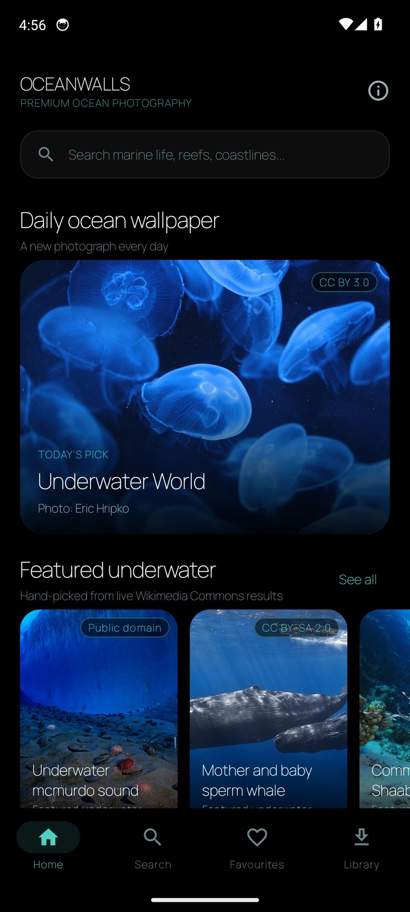
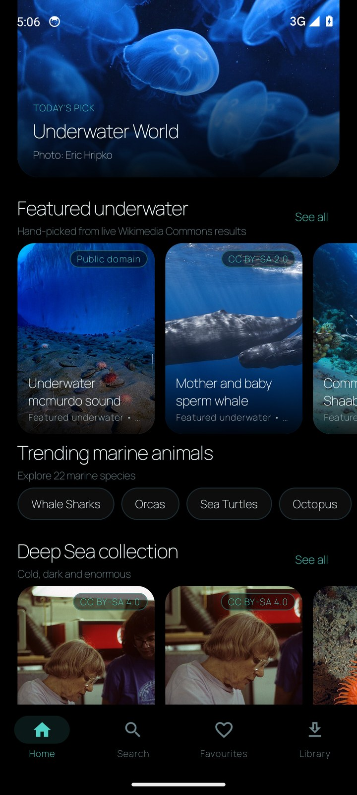
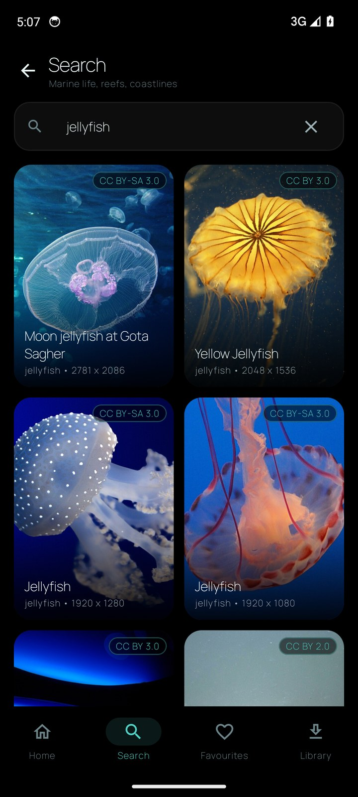
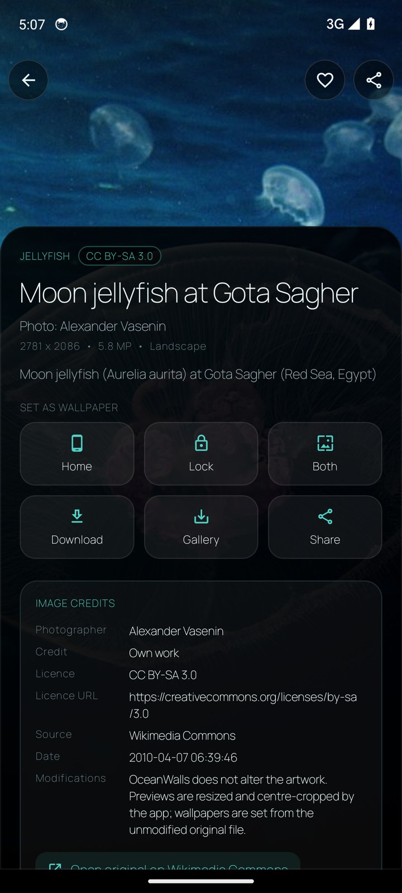
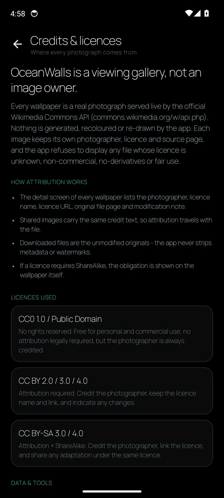

# OceanWalls

[](https://github.com/technicalnihilist-lgtm/OceanWalls/actions/workflows/android.yml)
-4FD1C5)


A premium, **live** ocean wallpaper app for Android. Every wallpaper is a real photograph
pulled at runtime from the official **Wikimedia Commons API** — nothing is bundled, nothing is
generated, and every image keeps its photographer, licence, licence URL and source page.

**[⬇ Download the APK](https://github.com/technicalnihilist-lgtm/OceanWalls/releases/latest)** ·
**[View screenshots](docs/screenshots)** ·
**[API verification report](docs/API_VERIFICATION.md)**

## Screenshots

Captured automatically by CI on a Pixel 6 emulator (Android 14) running the real build against
the live Commons API — these are not mockups.

| Home | Collections | Search |
|:---:|:---:|:---:|
|  |  |  |

| Wallpaper detail | Attribution | Credits & licences |
|:---:|:---:|:---:|
|  |  |  |

## What the app does

| Area | Implementation |
| --- | --- |
| Live feed | `generator=categorymembers` on curated Commons categories, falling back to full-text `generator=search` when a category is exhausted |
| Pagination | Real cursors (`gcmcontinue` for categories, `gsroffset` for search), encoded as `c:<token>` / `s:<offset>` |
| Attribution | `extmetadata` → Artist, Credit, LicenseShortName, LicenseUrl, ImageDescription, DateTimeOriginal |
| Licence gate | Strict allow-list: CC0, Public Domain, CC BY, CC BY-SA. Anything NC/ND/fair-use/unknown is rejected |
| Quality gate | JPEG photographs only; rejects maps, diagrams, paintings, book plates and taxonomy charts |
| **Ocean only, no people** | Photographs showing people are rejected — divers, tourists, swimmers, crowds, boats crewed by people, statues and museum specimens are filtered out by title, description and category signals |
| Duplicate prevention | Room primary key `(feedKey, pageId)` with `OnConflictStrategy.IGNORE` |
| Search | Debounced (450 ms) full-text search with infinite scroll and saved recent searches |
| Daily wallpaper | Deterministic rotating query per day, cached per calendar date |
| Recently added | `list=recentchanges` (namespace 6, new files) filtered for ocean subjects, then batch `imageinfo` |
| Downloads | Full-resolution original streamed to app storage with progress + atomic rename |
| Set wallpaper | `WallpaperManager.setBitmap(...)` with `FLAG_SYSTEM`, `FLAG_LOCK` or both, sampled decode |
| Gallery export | `MediaStore` insert into `Pictures/OceanWalls` (Q+) with a legacy path below Q |
| Favourites / recents | Room, kept on device, survive restarts |
| Sharing | `FileProvider` + `ACTION_SEND`, with the full credit block in `EXTRA_TEXT` |

## Screens

Home · Search · Category · Wallpaper detail · Favourites · Downloaded · Credits & licences.

Home carries: logo, search entry, **Daily ocean wallpaper**, Featured underwater, Trending marine
animals, Deep Sea collection, Popular ocean wallpapers, Coral reef collection, Ocean landscapes,
Recently added (live), Recently viewed and Special collections.

## Design

AMOLED black (`#000000`) canvas, deep teal surfaces, aqua accents (`#4FD1C5`), glassmorphism
panels, Manrope (SIL OFL) typography, 20–28 dp rounded cinematic cards, gradient scrims and no
bright distracting colour.

## Build

```bash
# Android Studio: open the folder and press Run.
./gradlew :app:assembleDebug        # APK at app/build/outputs/apk/debug/
```

Requirements: JDK 17, Android SDK platform 34 + build-tools 34.0.0. The wrapper is included.

## CI

`.github/workflows/android.yml` builds the debug APK on every push and then boots an Android 14
emulator, drives the app with `scripts/capture-screens.sh` and uploads the screenshots as an
artifact. Re-run it from the Actions tab (**Run workflow**) to refresh the screenshots.

## Project layout

```
app/src/main/java/com/oceanwalls/app/
├── core/AppContainer.kt            # manual DI: Retrofit, Room, repositories
├── data/
│   ├── model/                      # Wallpaper, FeedSpec, Catalog (52 categories)
│   ├── remote/                     # CommonsApi, DTOs, params, mapper, licence + quality gates
│   ├── local/                      # Room entities, DAOs, JSON codec, DataStore
│   ├── WallpaperRepository.kt      # paging, dedupe, daily pick, recent uploads
│   ├── DownloadRepository.kt       # real downloads + gallery export
│   └── FavoritesRepository.kt
├── ui/
│   ├── theme/                      # AMOLED palette, Manrope typography
│   ├── components/                 # glass panels, cards, chips, empty/error states
│   ├── feed/FeedController.kt      # pagination + "refresh brings new images"
│   ├── nav/OceanNav.kt
│   └── screens/                    # home, category, search, detail, favorites, downloads, credits
└── util/                           # WallpaperSetter, ShareHelper, HTML cleaner
```

## Licensing

App source: MIT (`LICENSE`). Bundled typeface Manrope: SIL Open Font License 1.1
(`app/src/main/assets/OFL-Manrope.txt`). Photographs: **their own licences**, shown per image —
OceanWalls never claims ownership of third-party photography.
